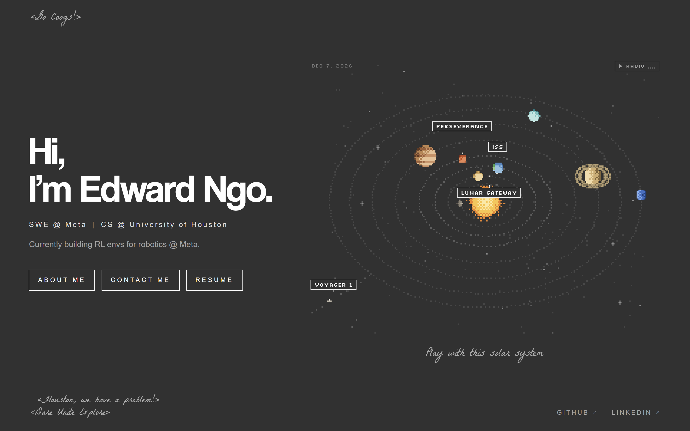
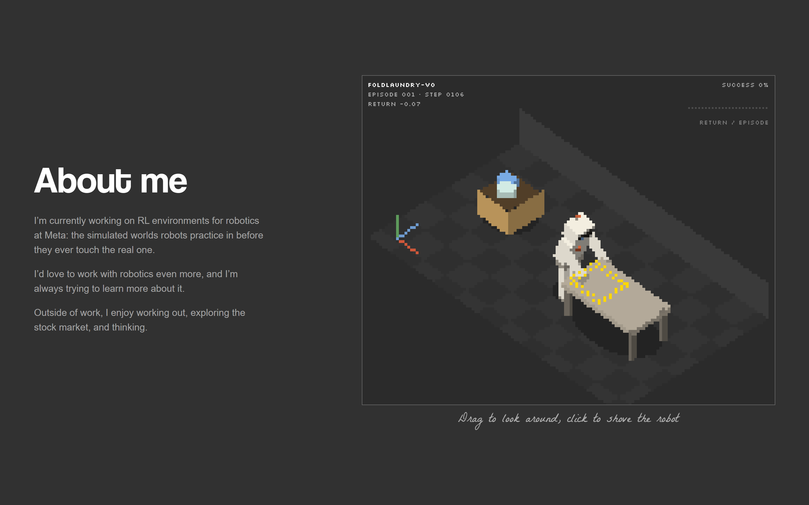
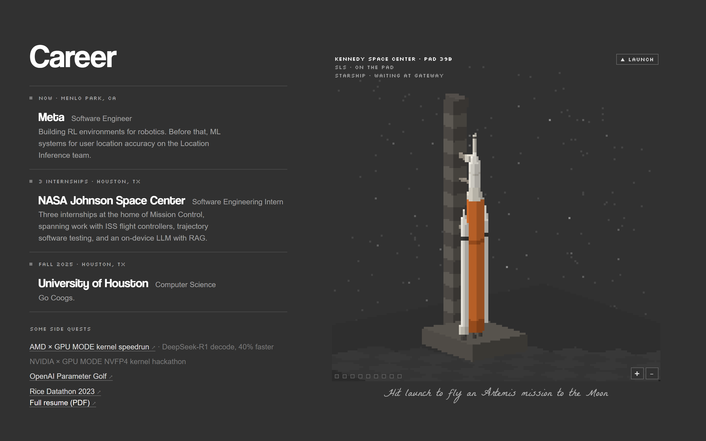
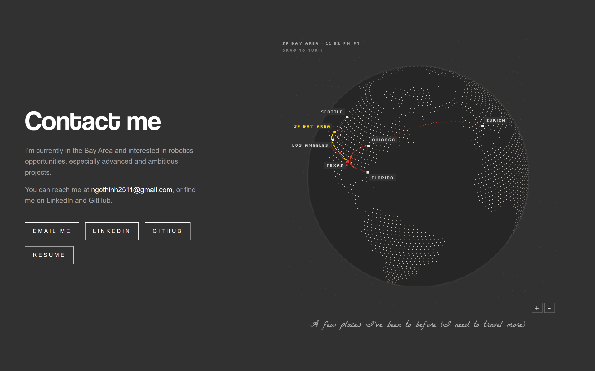

# Edward Ngo — personal site

Live at **https://thinngo2511.github.io/**

A one-page portfolio in plain HTML, CSS and JavaScript: no framework, no build step, nothing to install. Every scene is drawn in code as low-res pixel art and scaled up crisply.

## A quick tour

The page has four sections. Each one pairs some text with a small interactive scene. Click a screenshot to jump to that section on the live site.

### Home

[](https://thinngo2511.github.io/#home)

The intro sits next to a solar system that shows where the planets actually are today. Click the ISS, Lunar Gateway, Perseverance or Voyager 1 to zoom in and read about it. The **Radio** button plays synthesized static and beeps (sound is off until you press it).

### About

[](https://thinngo2511.github.io/#about)

A pixel humanoid robot learns to fold laundry in a tiny RL environment, with a HUD that tracks the episode, return and success rate. Drag to look around, click to shove the robot.

### Career

[](https://thinngo2511.github.io/#career)

Meta, three NASA Johnson Space Center internships, the University of Houston, a few side quests and a link to the full resume. Next to them is SLS on the pad at Kennedy. Hit **Launch** to fly a whole Artemis mission in about 90 seconds: liftoff through a cloud of deluge steam, a lap of Earth, the burn to the Moon, catching and docking with the Lunar Gateway for a lap of the Moon, a Starship lander taking two crew down to the south pole (its cargo elevator lowers a rover), then straight home to a splashdown in the Pacific next to a Ford-class carrier that launches Hornets, sends Seahawks out to the capsule and finishes with fireworks. **Pause** freezes it anywhere; while paused, the dots along the bottom step through the phases. Drag to look around, **+ / −** to zoom.

### Contact

[](https://thinngo2511.github.io/#contact)

Email, LinkedIn, GitHub and resume, next to a dotted globe with arcs from Houston to places I've been. Drag to turn, **+ / −** to zoom.

## How it's built

| Section | Scene | Script |
|---|---|---|
| Home | Solar system with today's real planet positions; click the ISS, Lunar Gateway, Perseverance or Voyager 1 to zoom in | `orrery.js` |
| About | A 3D robot learning to fold laundry in a little RL environment (drag to orbit, click to shove) | `sim.js` |
| Career | An Artemis Moon mission: SLS launch, Orion docking with the Lunar Gateway, a Starship landing and rover drive at the lunar south pole, and a splashdown with a carrier group (drag to orbit, +/− to zoom, pause, dots jump between phases) | `rocket.js` |
| Contact | Dotted globe of places I've been, arcs from Houston (drag to turn, +/− to zoom) | `globe.js` |

Shared pieces:

```
index.html            all content and copy
assets/css/site.css   colors, fonts and layout
assets/js/pixels.js   palette, sprites and the dithered-sphere renderer (solar system)
assets/js/tiny3d.js   tiny software 3D renderer used by the robot room and the Artemis mission
assets/js/radio.js    the "Radio" button: synthesized static and beeps (Web Audio, off by default)
assets/fonts/         Coolvetica and La Belle Aurore, from the original site
assets/img/           pegasus favicon
404.html              sends old links (/about, /contact) to the matching section
docs/screenshots/     the screenshots in this README (1440×900 at 2×)
```

The globe's coastlines come from Natural Earth's public-domain 1:110m land data, baked into a 2 KB bitmask inside `globe.js`. The Artemis scene borrows the same bitmask to paint Earth from orbit.

## Run locally

```bash
python3 -m http.server 4173
```

Then open http://localhost:4173.

## Editing

- **Words:** everything is in `index.html`; each section is commented.
- **Solar system info cards:** `INFO` near the top of `orrery.js`.
- **Places on the globe:** `PLACES` in `globe.js` (the `primary` one gets the yellow arc).
- **Artemis mission timing:** the `TL` mission clock and the `PHASES` list in `rocket.js`.

## Deploy

This repo is named `thinngo2511.github.io`, so GitHub Pages serves it at the root of that address, from the `main` branch. Push to `main` and the site updates. Old links to the previous address (`/Personal_Portfolio/…`) are redirected by `404.html`.

<details>
<summary>Previous version</summary>

The original React (Create React App) version lives in git history, before the `revamp` branch.
</details>
